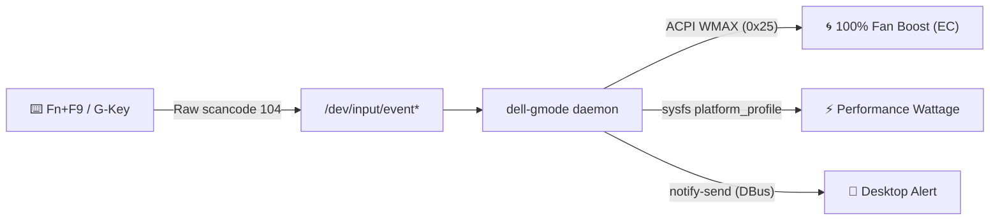

# Dell G15 / G16 Fn+F9 G-Mode (Game Shift) for Linux ⚡

[](LICENSE)
[](https://www.python.org/downloads/)
[](https://www.kernel.org/)
[](systemd/dell-gmode.service)
[](https://python-poetry.org/)
[](https://github.com/moalmatry/dell-gmode/stargazers)

> **Native Linux background daemon and CLI utility for Dell G15 and G16 gaming laptops to enable the Fn+F9 Game Shift (G-Mode) hardware toggle, 100% maximum fan cooling boost via Alienware WMAX ACPI, and CPU/GPU performance power profiles.**

---

## 📌 Table of Contents
- [Overview](#-overview)
- [Features](#-features)
- [Supported Hardware](#-supported-hardware)
- [How It Works](#-how-it-works)
- [Prerequisites & Dependencies](#-prerequisites--dependencies)
- [Installation](#-installation)
- [Usage](#-usage)
  - [Hardware Key (Fn+F9)](#using-the-hardware-key)
  - [CLI Commands](#using-the-cli-dell-gmode)
- [Service Management](#%EF%B8%8F-service-management)
- [Troubleshooting & FAQ](#-troubleshooting--faq)
- [Uninstallation](#-uninstallation)
- [Dell Linux Ecosystem](#-dell-linux-ecosystem)
- [Contributing](#-contributing)
- [License](#-license)

---

## 📖 Overview

On Dell G-Series gaming laptops, the dedicated **Game Shift (Fn+F9 / G-Key)** toggles Dell's proprietary high-performance thermal mode in Windows (Alienware Command Center / AWCC). Under Linux, this key is ignored by standard desktop environments (GNOME, KDE Plasma, XFCE, Hyprland, etc.), leaving laptops prone to thermal throttling during heavy gaming or compute workloads.

**`dell-gmode`** bridges this gap natively. It listens directly to the keyboard controller at the hardware level, commands the motherboard's Embedded Controller (EC) via ACPI WMAX calls to unleash **100% maximum fan speeds**, adjusts Linux `platform_profile` power governors, and notifies you through desktop alerts.

---

## 🚀 Features

* **⌨️ Hardware Fn+F9 Key Trigger:** Intercepts hardware scancode `104` (`0x68`) directly from the AT keyboard controller (`/dev/input`), functioning system-wide and inside full-screen games, Steam Proton, and Wine.
* **🌀 Alienware WMAX Fan Boost:** Sends direct ACPI WMAX calls to the Embedded Controller (EC) via `acpi_call` to override thermal curves and force 100% maximum fan speed.
* **⚡ CPU & GPU Performance Profiles:** Seamlessly switches the Linux kernel `platform_profile` to `performance` mode, unlocking full wattage and CPU governor scaling.
* **🔔 Native Desktop Notifications:** Dispatches on-screen alerts via user DBus (`notify-send`) confirming mode activation across active graphical sessions.
* **🪶 Ultra-Lightweight Systemd Daemon:** Runs continuously in the background consuming only **~2.5 MB of RAM** and **0% CPU** at idle.
* **💻 Intuitive CLI (`dell-gmode`):** Complete command-line control for manual toggling, status inspection, or custom window manager / compositor keybindings.
* **📦 Modern Packaging:** Built with Python 3.10+ and managed with [Poetry](https://python-poetry.org/).

---

## 💻 Supported Hardware

| Laptop Model | Processor Architecture | WMAX ACPI Method | Status |
| :--- | :--- | :--- | :--- |
| **Dell G15 5515** | AMD Ryzen (5000 Series) | `\_SB.AMW3.WMAX` | ✅ Fully Supported |
| **Dell G15 5520** | Intel Core (12th Gen) | `\_SB.AMWW.WMAX` | ✅ Fully Supported |
| **Dell G15 5511** | Intel Core (11th Gen) | `\_SB.AMWW.WMAX` / `AMW3` | ✅ Compatible |
| **Dell G15 5521 / 5525** | Intel / AMD Ryzen (6000 Series) | `\_SB.AMW3.WMAX` / `AMWW` | ✅ Compatible |
| **Dell G15 5530** | Intel Core (13th Gen) | `\_SB.AMWW.WMAX` | ✅ Compatible |
| **Dell G16 7620 / 7630** | Intel Core (12th / 13th Gen) | `\_SB.AMWW.WMAX` | ✅ Compatible |
| **Alienware m15 / x15 Series** | Intel / AMD | WMAX ACPI | ⚠️ Compatible |

> *Note: Also compatible with other Dell G-Series and Alienware laptops featuring the Game Shift key and the Alienware WMAX ACPI interface.*

---

## 🔍 How It Works



When you hit **Fn+F9**:
1. **Performance Mode (G-Mode Activated):**
   * Writes `performance` to `/sys/firmware/acpi/platform_profile` (or via `powerprofilesctl`).
   * Issues ACPI WMAX command `0 0x25 {0x1, 0x1, 0x00, 0x00}` to ramp fans to 100%.
   * Notification: `⚡ High Performance Mode Activated (Fans Maximum)`
2. **Balanced Mode (Quiet Profile):**
   * Writes `balanced` to `/sys/firmware/acpi/platform_profile`.
   * Issues ACPI WMAX command `0 0x25 {0x1, 0x0, 0x00, 0x00}` to return fans to standard curves.
   * Notification: `🍃 Balanced Mode Activated`

---

## 📦 Prerequisites & Dependencies

Before installation, make sure Python 3.10+, Poetry, and the `acpi_call` kernel module are installed for your distribution:

### 1. Ubuntu / Debian / Pop!_OS / Linux Mint
```bash
sudo apt update
sudo apt install -y python3-poetry acpi-call-dkms libnotify-bin
```

### 2. Arch Linux / Manjaro / EndeavourOS
```bash
sudo pacman -S poetry acpi_call libnotify
# Or if using DKMS:
# sudo pacman -S acpi_call-dkms
```

### 3. Fedora / RHEL
```bash
sudo dnf install -y poetry libnotify
# Enable RPM Fusion and install akmod-acpi_call:
sudo dnf install -y akmod-acpi_call
```

---

## 🚀 Installation

Clone the repository and run the automated installer:

```bash
git clone https://github.com/moalmatry/dell-gmode.git
cd dell-gmode
chmod +x install.sh
./install.sh
```

### What `install.sh` does:
1. Installs project dependencies inside an isolated Poetry environment.
2. Symlinks the executable to `/usr/local/bin/dell-gmode`.
3. Configures `/etc/modules-load.d/acpi_call.conf` so `acpi_call` loads automatically on system boot.
4. Installs and starts the `dell-gmode.service` systemd daemon.

---

## 🖥️ Usage

### Using the Hardware Key
Press **Fn+F9** (or the dedicated **G** key) anywhere in your session. The daemon debounces the input and toggles your mode instantly with a desktop notification.

### Using the CLI (`dell-gmode`)

```bash
# Toggle between Balanced and G-Mode
dell-gmode toggle

# Force High Performance G-Mode (Fans at 100%)
dell-gmode performance

# Restore Balanced Mode (Normal fan acoustic curves)
dell-gmode balanced

# Check current active mode
dell-gmode status
```

> **Tip:** You can bind `dell-gmode toggle` to custom shortcuts in i3, Sway, Hyprland, or KDE shortcuts!

---

## 🛠️ Service Management

Check daemon status and live key events:
```bash
systemctl status dell-gmode.service
```

Follow live daemon logs:
```bash
journalctl -u dell-gmode.service -f
```

Restart the daemon:
```bash
sudo systemctl restart dell-gmode.service
```

Stop or disable:
```bash
sudo systemctl stop dell-gmode.service
sudo systemctl disable dell-gmode.service
```

---

## ❓ Troubleshooting & FAQ

<details>
<summary><b>1. Fn+F9 key does not trigger anything</b></summary>

* Check if the service is running: `systemctl status dell-gmode.service`
* Test keyboard event listening manually:
  ```bash
  sudo dell-gmode daemon
  ```
  Press Fn+F9 and verify if `[⚡] Fn+F9 pressed` is printed.
* If your model uses a non-standard event node, ensure your user/service has permission to read `/dev/input/event*`.
</details>

<details>
<summary><b>2. Fans do not accelerate to 100%</b></summary>

* Verify that `acpi_call` is loaded:
  ```bash
  lsmod | grep acpi_call
  ```
* If it is missing, load it with:
  ```bash
  sudo modprobe acpi_call
  ```
* If Secure Boot is enabled, DKMS kernel modules may require signing with a MOK (Machine Owner Key) or disabling Secure Boot in the BIOS.
</details>

<details>
<summary><b>3. Notifications are not appearing</b></summary>

* Ensure `libnotify-bin` (or `libnotify`) is installed and a notification daemon (such as Dunst, Mako, GNOME Shell, or KDE Notifications) is running.
</details>

---

## 🗑️ Uninstallation

To cleanly remove the service, symlinks, and configuration:

```bash
cd dell-gmode
chmod +x uninstall.sh
./uninstall.sh
```

---

## 🌐 Dell Linux Ecosystem

Supercharge your Dell gaming laptop on Linux with companion tools from this suite:

* 🌈 **[dell-g15-rgb](https://github.com/moalmatry/dell-g15-rgb)** — Native Linux driver, CLI, and GTK 3 GUI for Dell G15 & Alienware laptops to control AlienFX 4-Zone RGB keyboard lighting, custom hardware effects, brightness, and permanently fix the "stuck on red" backlight issue.

---

## 🤝 Contributing

Contributions, bug reports, and hardware compatibility tests are welcome!
1. Fork the repository
2. Create your feature branch (`git checkout -b feature/amazing-feature`)
3. Commit your changes (`git commit -m 'Add support for Dell G15 55xx'`)
4. Push to the branch (`git push origin feature/amazing-feature`)
5. Open a Pull Request

---

## 📄 License

Distributed under the **MIT License**. See [`LICENSE`](LICENSE) for details.
